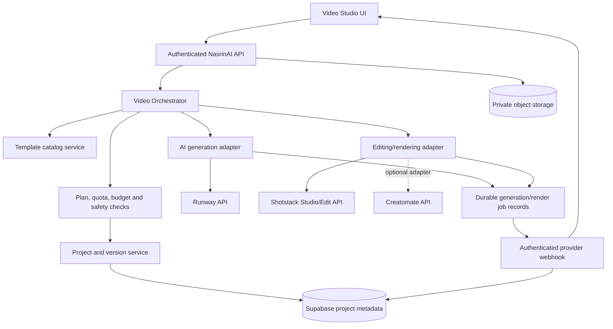

# NasrinAI Video Studio — Architecture & Implementation Specification

**Status:** Initial frontend MVP implemented on feature branch; full cloud timeline rendering and cloud project sync remain pending  
**Last updated:** 2026-10-20  
**Owner:** NasrinAI product engineering  
**Scope:** Full AI Video Studio combining provider and original templates, a timeline-based editor, and AI-generated footage.

## 1. Product outcome

Build a first-class Video Studio where a user can:
- Browse and search a template library that combines provider-licensed templates with original NasrinAI templates.
- Start from a template, a blank timeline, uploaded assets, or an AI prompt.
- Edit clips, trim/split/reorder, adjust aspect ratio, titles, captions, transitions, audio, voice-over, overlays, branding, and basic color/layout settings.
- Generate footage from text prompts or reference images, then import those generated clips into the same editable project.
- Preview, save versions, render/export MP4, track progress, and return to completed projects after refreshing or signing in on another device.
- See clear errors, progress, duration/resolution limits, and estimated usage before expensive work.

The first implementation slice adds a responsive standalone workspace, original template cards, a prompt-to-video flow using the existing authenticated `/v1/videos` generation pipeline, an editable local timeline, generated-clip preview/download, and browser-local draft metadata. It does not yet render a composed multi-clip timeline, synchronize projects across devices, or connect Shotstack/Creatomate. Do not describe the full Video Studio as production-complete until those parts are implemented and tested.

## 2. Provider recommendation

### Primary editing/rendering engine: Shotstack

Evaluate Shotstack Studio SDK for the browser-based timeline/editor foundation and Shotstack Edit API for server-side rendering. Its documented model supports programmatic editing and cloud rendering; the team must prove that the SDK covers our required timeline controls and UX before committing to it.

- Studio SDK: https://shotstack.io/docs/guide/studio-sdk/
- Edit API: https://shotstack.io/docs/api/
- Product: https://shotstack.io/

### AI video generation: Runway API adapter

Use Runway as the first candidate for text/image-to-video generation, subject to model access, commercial terms, supported durations/aspect ratios, pricing, and quota verification.

- Developer documentation: https://docs.dev.runwayml.com/
- Product: https://runwayml.com/

### Template-rendering alternative: Creatomate

Evaluate Creatomate for branded/template-driven rendering and bulk variants. Do not add it as a mandatory runtime dependency until a proof of concept shows a real gap Shotstack cannot cover or its template workflow is materially better.

- Product: https://creatomate.com/
- API docs: https://creatomate.com/docs/api/quick-start/create-a-video-by-template

### Provider-selection rule

Do not bind the entire product to one provider's proprietary project format. Keep an internal canonical project/timeline model and isolate every provider behind an adapter. Provider capability and price must be checked against current official documentation and the user's plan before execution. Do not promise that a provider feature exists merely because a catalog entry exists.

## 3. High-level architecture

The diagram is intended as an architecture map. Confirm the repository's existing deployment and job infrastructure before choosing exact files, queues, and hosting.

## 4. Frontend workspaces

1. **Discover** — template gallery, categories, search, filters, tags, aspect ratio, duration, and provider/original labels.
2. **Create** — prompt-to-video flow with style, aspect ratio, intended platform, duration, reference assets, and a cost/plan estimate.
3. **Editor** — preview canvas, responsive timeline, tracks, clip controls, media bin, text/caption tools, audio controls, transitions, undo/redo, autosave and keyboard support.
4. **Assets** — uploads, generated clips, voice-over, music, thumbnails, and project media.
5. **Export** — output format, resolution, frame rate where supported, render progress, cancellation if supported, retry, download and share controls.
6. **My Projects** — saved projects, last edited, render state, versions, duplicate, rename and delete.

Keep the interface premium and restrained, with responsive controls and special attention to iPhone Safari. Do not ship inert controls or fake progress. Every visible action must be backed by a real operation or clearly disabled with an explanation.

## 5. Canonical project model

Persist a provider-neutral representation, including:
- Project ID, owner/tenant, title, created/updated timestamps, version, status and aspect ratio.
- Timeline tracks and ordered clips with start time, duration, trim in/out, source asset, playback speed where supported, volume, and transforms.
- Text/title/caption overlays, fonts, positions, colors and timing.
- Audio tracks, volume, fade, and voice-over references.
- Transition/effect identifiers and settings, only when supported by the selected renderer.
- Source asset ownership, MIME type, byte size, checksum, storage key and provenance (upload, original template, licensed provider template, AI generation).
- Render settings, provider job ID, output metadata, error category and timestamps.

Treat provider-native project payloads as adapter-specific metadata, not the only saved source of truth. Version the canonical schema and provide migrations when it changes. Do not silently discard unsupported edits when switching renderers.

## 6. Template catalog and licensing

Support two distinct origins:
- **NasrinAI Originals:** templates designed and owned by NasrinAI, with internal template IDs, versions, preview images, editable slots, tags and supported output profiles.
- **Provider templates:** only templates whose provider terms permit the intended display, editing, rendering, redistribution and commercial use. Store provider ID, source URL, license/terms reference, attribution requirements, availability and last verification.

Each template should declare editable fields, required assets, fonts/music licensing, allowed duration/aspect ratios, supported renderer, preview, and fallback behavior. Do not scrape or copy template assets from third-party sites without permission. Never imply that a provider template is a NasrinAI original.

## 7. Backend APIs and job lifecycle

Define routes following the repository's existing API conventions; final route names must be reconciled with existing routing before implementation. Candidate capabilities:
- List/search templates and retrieve template details.
- Create/read/update/version/duplicate/delete an owned project.
- Request AI generation and poll/cancel a generation job where supported.
- Create a render job from a validated project version.
- Read render status and retrieve the completed output through an owner-authorized route.
- Receive provider webhooks and reconcile job state.

Long-running generation/render tasks must be asynchronous. Store job state durably; never rely on a browser tab or in-memory server process to preserve the job. Suggested state machine: `queued → validating → running → succeeded | failed | cancelled`, with retries tracked separately. Enforce idempotency to avoid duplicate paid jobs on retries. Verify webhook signatures or use authenticated polling when signatures are unavailable; reject replayed or mismatched job events.

## 8. Storage, security and tenant isolation

- Keep provider API keys and privileged Supabase credentials server-side only; use deployment environment variables, never hardcoded defaults or client bundles.
- Authenticate every project mutation and confirm project ownership/tenant membership on every read, write, render, download and delete.
- Use private storage and short-lived signed URLs. Validate file type by content where feasible, size, duration, dimensions and decoded media metadata. Apply upload limits before expensive processing.
- Do not accept arbitrary provider URLs or use the server as an unrestricted URL fetcher; defend against SSRF and unsafe redirects.
- Sanitize text/metadata; escape all user-provided content in the UI. Keep CSP restrictive and do not inject provider HTML.
- Configure Supabase RLS for all new user-owned tables. Browser roles should not gain unnecessary direct table or storage privileges.
- Add retention/deletion behavior for source uploads, generated intermediates, failed jobs and exported files. Clearly disclose retention and third-party processing.
- Keep provider error details in protected diagnostics; show users provider-neutral, actionable messages.
- Never log API keys, signed URLs, raw private media, or unnecessary personal data.

## 9. Usage, cost and plans

Reuse the existing NasrinAI plan/usage policy only after checking the current implementation and production environment. Do not invent new token limits or expose internal provider pricing as if it were the user's bill.

Before starting an expensive job:
1. Validate account, plan, quota, duration, output settings and provider capability.
2. Estimate usage/cost where the provider offers reliable pricing.
3. Require confirmation when cost is material or unclear.
4. Atomically reserve quota to prevent concurrent overspend.
5. Record provider job ID and an idempotency key.
6. Reconcile actual usage and release unused reservations on failure/cancellation.
7. Apply per-user, per-tenant, per-IP and global abuse limits independently.

Use server-side policy for plan enforcement. Hiding a button is not authorization. Follow the product's current entitlement rules; the existing product has an Ultra-only async video-generation path up to one minute, so any broader access or duration must be an explicit, reviewed product change rather than silently expanding existing access.

## 10. Observability and reliability

Record job lifecycle timestamps, queue wait, provider latency, render duration, status, retries, failure class, output size and reconciled cost. Use request IDs and provider job IDs to correlate logs without exposing secrets or media content. Add alerts for sustained provider failures, stuck jobs, webhook failures and cost spikes. Add timeout, bounded retry with backoff, dead-letter/recovery handling, and user-visible recovery actions.

## 11. Required test plan

- Unit tests for canonical timeline validation, adapter mapping, template metadata, entitlement and cost calculations.
- Integration tests with mocked provider APIs for accepted/rejected requests, timeouts, malformed responses, retries, duplicate submissions and webhook replay.
- Database/RLS tests for cross-user and cross-tenant access denial, signed URL permissions, job ownership and deletion.
- End-to-end tests for template selection → edit → save → render → download; AI prompt → generation → import into timeline → edit → render; and reload/reopen while a job is running.
- UI tests for responsive gallery/editor, keyboard operation, accessibility, autosave conflict handling, failure states and mobile Safari.
- Live provider smoke tests only with explicitly configured test credentials and bounded spend.
- Full repository tests, dependency/security scans, secret scans, migration checks and preview deployment checks before merge.

## 12. Phased delivery

**Phase 0 — proof of concept:** compare Shotstack Studio/Edit API and Creatomate on the same 2–3 representative templates. Measure edit capability, output quality, render latency, mobile editor usability, licensing, reliability and cost.

**Phase 1 — project foundation:** schema, RLS, private storage, canonical timeline model, autosave/versioning, job persistence and provider adapters.

**Phase 2 — template MVP:** searchable gallery, NasrinAI originals, licensed provider templates, editable slots and reliable MP4 rendering.

**Phase 3 — editor:** timeline, clip trimming/reordering, titles, captions, audio, transitions, preview, undo/redo and export.

**Phase 4 — AI generation:** Runway adapter, prompt/reference-image flow, asynchronous job handling, generated-asset import into the timeline and provider-neutral failure recovery.

**Phase 5 — production hardening:** usage reservation/reconciliation, quotas, webhooks, monitoring, deletion/retention, accessibility, mobile QA, security review and deployment verification.

## 13. Definition of done

Do not call Video Studio production-ready until:
- The provider choice is supported by a documented proof-of-concept comparison.
- Real templates can be edited and exported; original and provider assets are correctly licensed and labeled.
- AI-generated clips can be imported into an editable timeline and exported.
- Projects and jobs survive refreshes and server restarts.
- Authentication, RLS, private media access, quota enforcement and webhook/polling security pass tests.
- The full test suite and required CI/security/database checks pass.
- Staging and production status are verified separately, and all remaining limitations are documented.

## 14. Decision record

**Proposed renderer decision:** retain the existing Gemini Veo video-generation route for generated footage; evaluate Shotstack Studio/Edit API as the cloud timeline renderer and Creatomate as a template-rendering comparator. Do not introduce Runway by default when the repository already has an established Veo provider path. The first UI slice uses the existing Veo route and does not yet submit full timeline renders.

**Not yet decided:** final provider contracts/pricing, editor SDK feature coverage, exact schema/routes, worker topology, storage retention, supported resolutions/frame rates, template licensing inventory, and plan-specific limits. Verify each before implementation.

## 15. Implementation checkpoint — initial frontend MVP

Added in the Video Studio feature branch:
- `public/video-studio.html`, `public/video-studio.css`, `public/video-studio.js`.
- Original template gallery for cinematic, social, product, and travel-story starting points.
- Prompt-to-video generation via the existing authenticated `POST /v1/videos` endpoint; polls the existing video job status route and loads owned MP4s using bearer-authenticated fetches.
- Timeline clip list with reorder, rename, title metadata, trim-start/duration fields, removal, uploaded media previews, and responsive layout.
- Browser-local draft metadata and generated clip downloads; no claims of cloud sync.
- Desktop navigation entry and a focused regression test file.

Known MVP boundaries:
- Timeline title/trim/reorder edits are currently project metadata and do not alter the generated MP4 file.
- Uploads and unsaved media blobs are browser-session only; local draft metadata does not upload assets.
- Full composed MP4 export requires a server-side rendering adapter and provider credentials; this branch intentionally does not fake a successful export.
- The initial templates are original UI concepts, not third-party provider templates.
